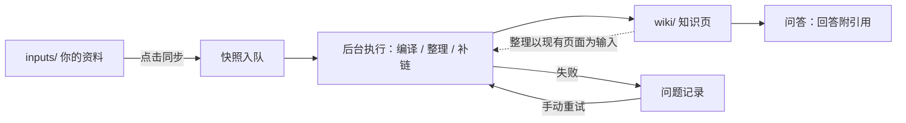

# wiki-agent

基于 LLM 的本地知识库编译与问答工具：把零散的笔记与文档编译成结构化 Wiki，支持一键同步、增量更新、组织整理与基于引用的问答。


## 环境要求

1. **一个 OpenAI 兼容的模型服务**：本地部署或云端 API 均可。本地部署时资料不出本机；使用第三方 API 时资料将发送至该服务，请先评估数据外发风险。
2. **Python ≥ 3.13 与 [uv](https://docs.astral.sh/uv/)**（本机安装时）。
3. **磁盘**：不要求 GPU；依赖包含本地 PDF/图片解析器（torch/MinerU），虚拟环境约占 5 GB，Docker 镜像与首次解析 PDF 的模型下载另有数 GB。

## 快速开始

### 本机安装

```bash
git clone https://github.com/Zi-Lan-Cui/wikiagent.git
cd wikiagent
uv sync
mkdir -p inputs wiki workspace
```

将模型信息写入 `env/.env`（示例文件 `env/.env.example`）：

```ini
LLM_API_KEY=你的密钥
LLM_BASE_URL=https://api.openai.com/v1 # 或自建 OpenAI 兼容接口
LLM_MODEL_ID=gpt-4o-mini
```

验证安装：

```bash
uv run wiki-agent --list
```

不报错即安装成功。随后启动 Web 工作台：

```bash
uv run uvicorn wiki_agent.web:create_app --factory --port 8000
```

浏览器打开 http://localhost:8000 。把自己的笔记（md、pdf、docx、图片）放入 `inputs/`，在维护页点击同步，后台即开始编译知识页。命令行用法见[使用方法](#使用方法)。

### Docker

```bash
git clone https://github.com/Zi-Lan-Cui/wikiagent.git
cd wikiagent
# 先在 env/.env 填好上面三个键
mkdir -p inputs wiki workspace
docker compose up -d --build   # 首次构建需下载全部依赖，预留磁盘与时间
docker compose ps              # 结果为 healthy 即可用
```

浏览器打开 http://localhost:8000 。wiki、运行数据与日志挂载在宿主机目录，重建容器不丢失数据。容器内的服务占用执行锁与 8000 端口，如需使用命令行，先 `docker compose stop`，用完 `docker compose up -d` 恢复 Web 服务。

### 常见错误

| 现象 | 处理 |
|---|---|
| `缺少 LLM API key——请在 env/.env 中设置 LLM_API_KEY` | 创建 `env/.env` 并填入密钥 |
| `另一执行进程……正持有 exec.lock` | 命令行与 Web 工作台不可同时运行，先停止其中一个 |
| `address already in use` | 8000 端口被占用；改用 `--port 8001` 或停掉占用进程 |
| Docker 拉取基础镜像（ghcr.io）失败 | 换镜像站构建：`docker compose build --build-arg BASE_IMAGE=ghcr.m.daocloud.io/astral-sh/uv:python3.13-bookworm-slim && docker compose up -d` |

## 它好在哪

- **多格式整合**：Markdown、PDF、Word 文档与图片可一并放入，编译为同一套知识页。
- **增量同步**：只处理新增与改动的文件；删除的文件自动清理对应页面与引用记录。
- **结果可回退**：知识页改动存有 Git 历史，执行失败自动撤销，不满意可整批回退。
- **结构可维护**：新增资料按页面自身使命比对归属，减少误合并；可随时分析全库并提出合并、拆分、清理建议，经确认后执行。
- **访问边界明确**：文件读写限于 wiki 目录内，其余路径一律拒绝。

## 使用方法

资料经同步快照进入队列，后台编译成 Wiki 页面；问答与整理都发生在这些页面之上，失败记录留存供重试。



### Web 工作台

一个界面三块功能，交互便捷，为推荐使用的主入口：

- **对话**：与知识库问答，回答附引用位置，支持多会话；

  

- **Wiki 浏览**：目录、页面结构与交叉链接；

  

- **维护**：发起同步、结构整理、补全链接任务并监视进度，失败任务在此重试。

  

### 命令行

同步资料，首次全量编译，之后只处理新增与改动：

```bash
uv run python scripts/sync.py inputs
```

向知识库提问，答案附上引用位置；`--list` 查看历史会话，`--resume <会话id>` 恢复会话：

```bash
uv run wiki-agent
```

页面有重复、过长或归属不当时可整理结构；链接缺失时用补链脚本。两者都先给出提议清单、经确认才执行，单条不满意可单独撤销。整理要求资料均已同步：

```bash
uv run python scripts/restructure_wiki.py --dry-run   # 先看提议
uv run python scripts/link_wiki.py                    # 全库补链
uv run python scripts/link_wiki.py concepts/a         # 或只处理指定页
```

## 数据目录与配置

- `inputs/`：你自己的资料（md、pdf、docx、图片），系统只读取；
- `wiki/`：生成的知识页，由系统维护，不建议直接编辑；
- `workspace/`：运行状态、日志与会话数据。

三个目录默认在项目根下，互不嵌套即可用 `WIKI_INPUTS_DIR`、`WIKI_WIKI_DIR`、`WIKI_WORKSPACE_DIR` 移至别处；备份与迁移打包这三个目录即可。

配置集中在 `env/.env`，完整项与注释见 `env/.env.example`：

| 键 | 说明 | 必填 | 默认 |
|---|---|---|---|
| `LLM_API_KEY` | 模型服务密钥 | 是 | 空 |
| `LLM_BASE_URL` | OpenAI 兼容接口地址 | 是 | 空 |
| `LLM_MODEL_ID` | 模型名 | 是 | 空 |
| `VLM_*` | 多模态模型，为图片生成说明文字 | 否 | 不启用 |
| `WIKI_INPUTS_DIR` 等 | 三个数据目录的位置 | 否 | 项目根下同名目录 |
| `COMPILE_*` / `AGENT_*` | 编译并发、上下文窗口等预算参数 | 否 | 见示例文件 |
| `env/mcp.json` | 接入外部工具服务（可选能力） | 否 | 无 |

## 开发检查

```bash
make check
```

依次运行 ruff、pyright 与不依赖真实模型的全量测试；也可单独执行：

```bash
uv run ruff check .
uv run pyright
uv run pytest -m "not live"
```

## 项目结构

```text
src/wiki_agent/   核心运行时代码，按业务领域组织
scripts/          同步、结构整理、补链等运维入口
frontend/         Web 工作台静态页面
test/             自动化测试
evals/            评测框架与题集
env/.env.example  配置示例
```

## 许可

[MIT License](LICENSE)
