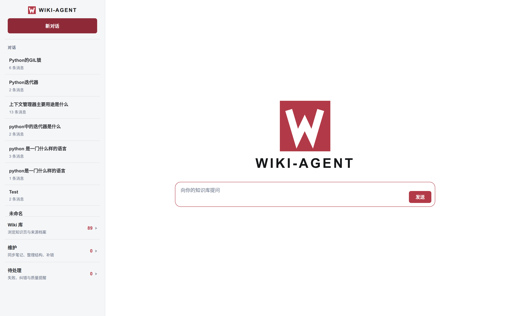
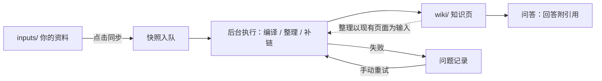
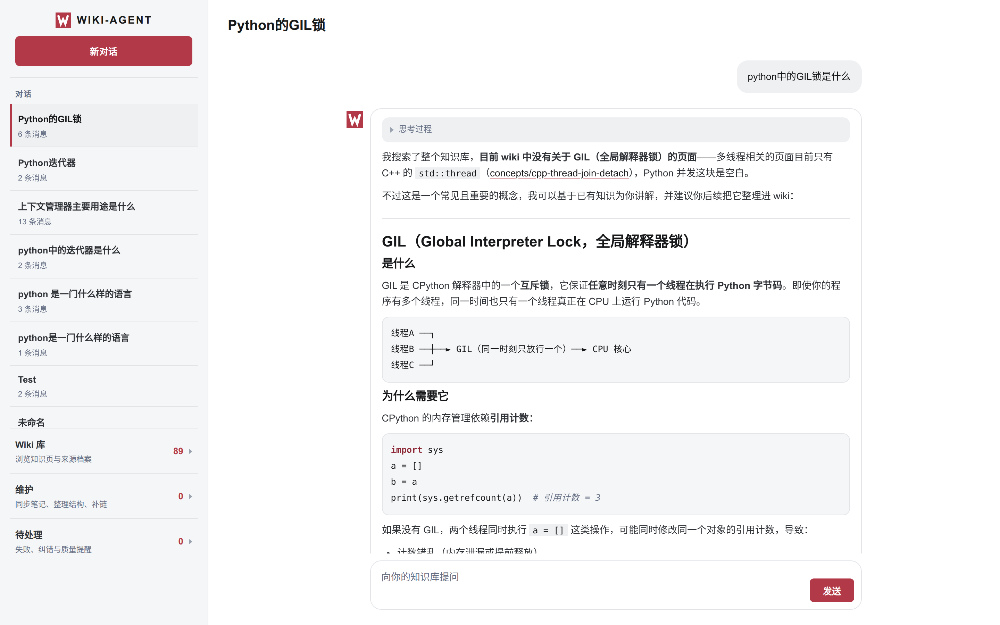
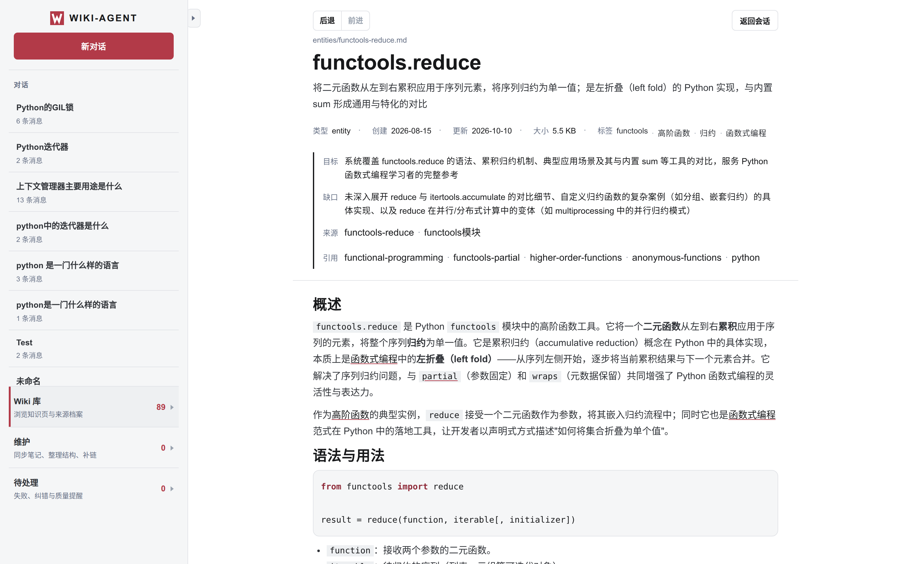
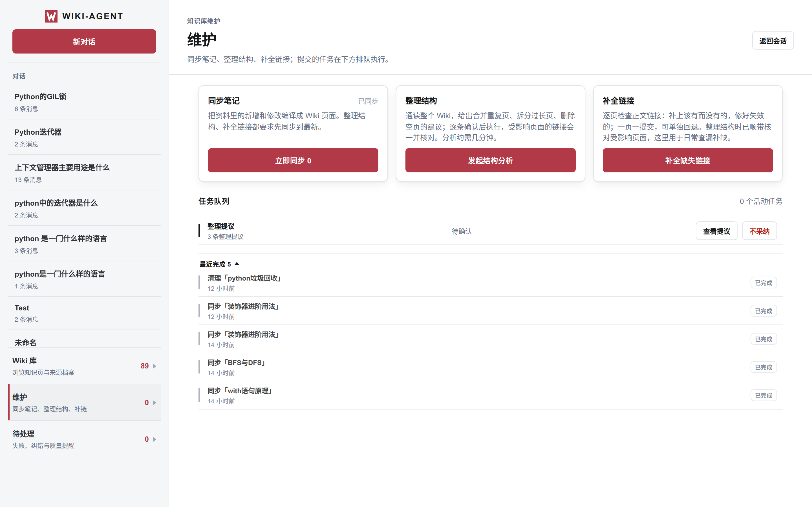

# wiki-agent

基于 LLM 的本地知识库编译与问答工具：将零散笔记文档编译成结构化 Wiki，支持一键同步、结构整理与知识库问答，提升你的知识管理效率。



## 它好在哪

- **多格式整合**：Markdown、Excel、PDF开箱即用；按文档结构化程度针对解析方式，提取结果更优质。可选 MinerU 解析版面，质量更高。
- **增量同步**：只处理新增与改动的文件；删除的文件自动清理对应页面与引用记录。
- **版本化管理**：知识页改动存有 Git 历史，执行失败自动撤销，不满意可整批回退。
- **易于维护**：可自动根据仓库状态生成重组计划，可以自由拆分、聚合已有 Wiki ，保持知识库结构清晰。

## 快速开始

### Docker

```bash
git clone https://github.com/Zi-Lan-Cui/wikiagent.git
cd wikiagent
mkdir -p inputs wiki workspace
```

将模型信息写入 `env/.env`（示例文件 `env/.env.example`）：

```ini
LLM_API_KEY=你的密钥
LLM_BASE_URL=https://api.openai.com/v1 # 或自建 OpenAI 兼容接口
LLM_MODEL_ID=gpt-4o-mini

# 处理图片资料时再配一组多模态模型（可选）：
# VLM_API_KEY=多模态模型密钥
# VLM_BASE_URL=https://api.openai.com/v1
# VLM_MODEL_ID=你的视觉模型名
```

```bash
docker compose up -d --build   # 首次构建需下载依赖（默认轻量解析链）
docker compose ps              # 结果为 healthy 即可用
```

浏览器打开 http://localhost:8000 。wiki、运行数据与日志挂载在宿主机目录，重建容器不丢失数据。镜像默认走轻量解析链；如需在容器内解析 PDF、Word、PPT，在 Dockerfile 的两处 `uv sync` 加上 `--extra mineru` 后重新构建。

### 源代码安装（不支持 Windows）

```bash
git clone https://github.com/Zi-Lan-Cui/wikiagent.git
cd wikiagent
uv sync
uv sync --extra mineru   # 可选：PDF、Word、PPT 的 MinerU 版面解析
mkdir -p inputs wiki workspace
```

将模型信息写入 `env/.env`（示例文件 `env/.env.example`）：

```ini
LLM_API_KEY=你的密钥
LLM_BASE_URL=https://api.openai.com/v1 # 或自建 OpenAI 兼容接口
LLM_MODEL_ID=gpt-4o-mini

# 处理图片资料时再配一组多模态模型（可选）：
# VLM_API_KEY=多模态模型密钥
# VLM_BASE_URL=https://api.openai.com/v1
# VLM_MODEL_ID=你的视觉模型名
```

验证安装：

```bash
uv run wiki-agent --list
```

不报错即安装成功。随后启动 Web 工作台：

```bash
uv run uvicorn wiki_agent.web:create_app --factory --port 8000
```

浏览器打开 http://localhost:8000 。把自己的笔记（md、pdf、docx、图片）放入 `inputs/`，在维护页点击同步，后台即开始编译知识页。

### 常见错误

| 现象                                                     | 处理                                                                                                                                           |
| -------------------------------------------------------- | ---------------------------------------------------------------------------------------------------------------------------------------------- |
| `缺少 LLM API key——请在 env/.env 中设置 LLM_API_KEY` | 创建`env/.env` 并填入密钥                                                                                                                    |
| `address already in use`                               | 8000 端口被占用；改用`--port 8001` 或停掉占用进程                                                                                            |
| Docker 拉取基础镜像（ghcr.io）失败                       | 换镜像站构建：`docker compose build --build-arg BASE_IMAGE=ghcr.m.daocloud.io/astral-sh/uv:python3.13-bookworm-slim && docker compose up -d` |

## 使用方法

资料经同步快照进入队列，后台编译成 Wiki 页面；问答与整理都发生在这些页面之上，失败记录留存供重试。



### Web 工作台

一个界面三块功能，交互便捷，为推荐使用的主入口：

- **对话**：与知识库问答，回答附带具体引用位置；

  
- **Wiki 浏览**：目录、页面结构与交叉链接；

  
- **维护**：可发起同步、结构整理、补全链接任务并监视进度，用于防止资料规模增大，造成的结构混乱和维护困难问题。

  

## 数据目录与配置

- `inputs/`：你自己的资料（md、pdf、docx、图片），系统只读取；
- `wiki/`：生成的知识页，由系统维护，不建议直接编辑；
- `workspace/`：运行状态、日志与会话数据。

三个目录默认在项目根下，互不嵌套即可用 `WIKI_INPUTS_DIR`、`WIKI_WIKI_DIR`、`WIKI_WORKSPACE_DIR` 移至别处；备份与迁移打包这三个目录即可。

配置集中在 `env/.env`，完整项与注释见 `env/.env.example`：

| 键                          | 说明                                                | 必填 | 默认             |
| --------------------------- | --------------------------------------------------- | ---- | ---------------- |
| `LLM_API_KEY`             | 模型服务密钥                                        | 是   | 空               |
| `LLM_BASE_URL`            | OpenAI 兼容接口地址                                 | 是   | 空               |
| `LLM_MODEL_ID`            | 模型名                                              | 是   | 空               |
| `VLM_*`                   | 多模态模型，为图片生成说明文字                      | 否   | 不启用           |
| `WIKI_INPUTS_DIR` 等      | 三个数据目录的位置                                  | 否   | 项目根下同名目录 |
| `COMPILE_PARSE_BACKEND`   | 解析后端：auto 优先内置、装有 MinerU 则兜底版面格式 | 否   | auto             |
| `COMPILE_*` / `AGENT_*` | 编译并发、上下文窗口等预算参数                      | 否   | 见示例文件       |
| `env/mcp.json`            | 接入外部工具服务（可选能力）                        | 否   | 无               |

## 开发检查

```bash
make check
```

依次运行 ruff、pyright 与不依赖真实模型的全量测试；也可单独执行：

```bash
uv run ruff check .
uv run pyright
uv run pytest -m "not live"
```

## 项目结构

```text
src/wiki_agent/   核心运行时代码，按业务领域组织
scripts/          同步、结构整理、补链等运维入口
frontend/         Web 工作台静态页面
test/             自动化测试
evals/            评测框架与题集
env/.env.example  配置示例
```

## 许可

[MIT License](LICENSE)
